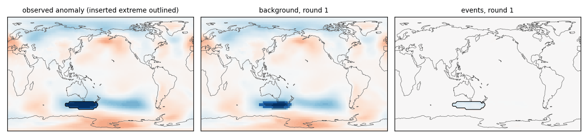
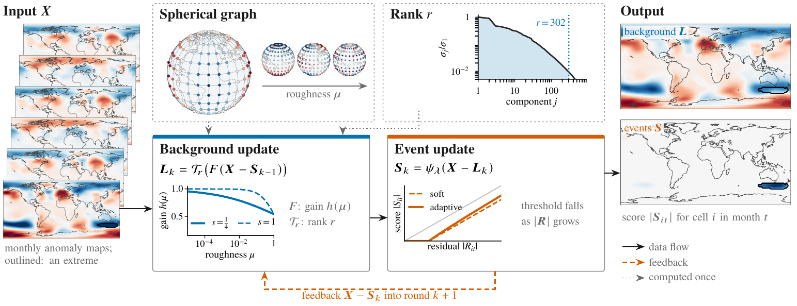
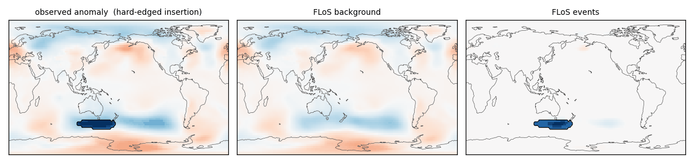
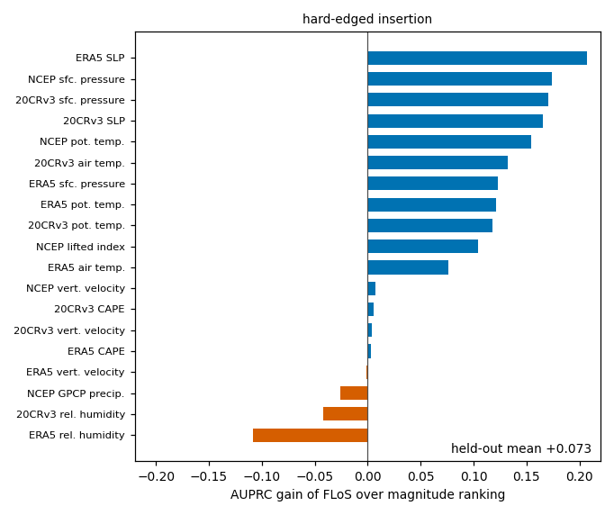
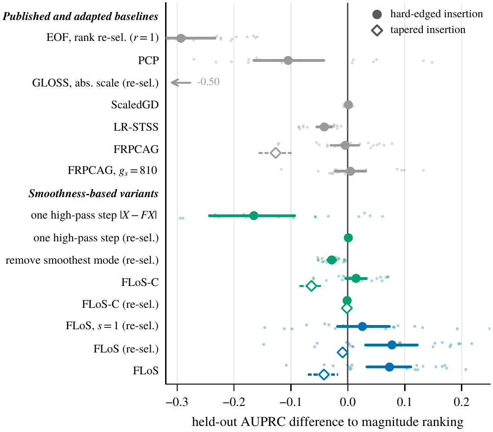
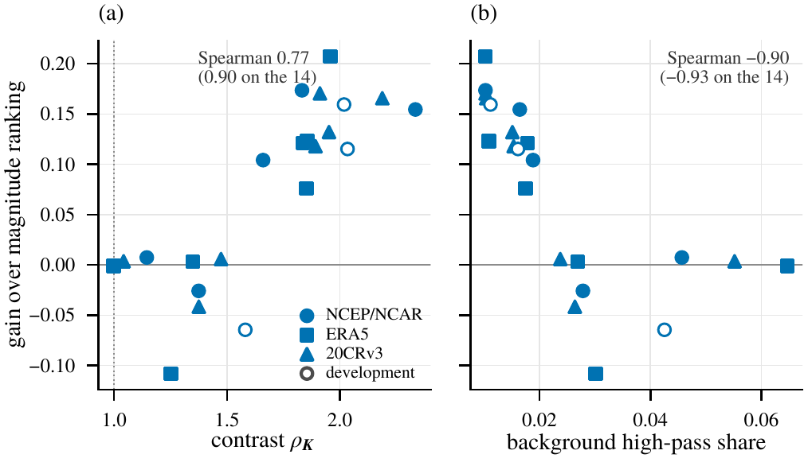
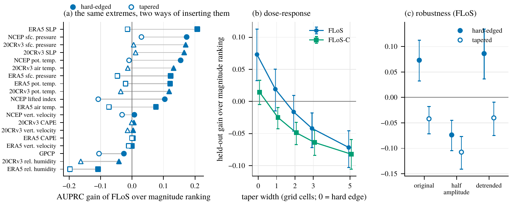

# FLoS: Spherical Smoothness Priors for Separating Extremes from High-Rank Climate Fields

Code, result files and figures for the paper

> **Spherical Smoothness Priors for Separating Extremes from High-Rank Climate Fields**<br>
> Maolin Wang, Hongyu Chen, Shuhua Yang, Haoxuan Li, Zhaoning Zhang, Hing Cheung So<br>

<p align="center">
  <br>
  <em>FLoS on one month of 20CRv3 sea-level pressure, round by round. The inserted extreme (outlined) moves out of
  the background and into the event component over the first 30 or so rounds, while the surrounding weather pattern
  stays in the background.</em>
</p>

## What FLoS does

Decomposition-based detection writes a field as a background plus sparse events and reads events off what the
background cannot explain, so **the background model is the detector**. The prevailing choice, a low-rank background,
lets the patterns with the most variance be explained for free. Climate anomaly fields have no gap in their spectrum,
so no rank is both small enough to exclude the events and large enough to hold the background; tuned low-rank
detectors end up no better than ranking the anomalies by magnitude.

**FLoS** (Fractional Laplacian on a Spherical graph) orders patterns by **roughness instead of variance**:

* a graph on the sphere, with the cells of each polar row merged and edges weighted by inverse great-circle distance;
* a background filter that discounts every pattern by `1 / (1 + alpha * mu^s)`, where `mu` is the pattern's
  roughness (Laplacian eigenvalue) and the fractional exponent `s` sets how fast the discount grows;
* a truncation of the filtered background at a rank read from the data (optimal hard threshold, not assumed small);
* an adaptive shrinkage of the residual, which spares large entries so that events keep their amplitude.

<p align="center"></p>

Its convex core **FLoS-C** (no truncation, soft threshold) is a sparse regression that charges every residual pattern
by its roughness and is solved by iterative shrinkage-thresholding. Its analysis shows that no shrinkage rule can
reorder the scores of a given background, and that the prior favours events over the background exactly by a
measurable **roughness contrast**.

## What we found

On a benchmark that transplants observed extremes into other years, FLoS is the most accurate method on 15 of 19
held-out variables, ahead of magnitude ranking by 0.073 AUPRC, and its gain grows with the roughness contrast.
That benchmark inserts each extreme with a **hard edge**, however, and an edge is rough by construction. Inserted
together with their own surroundings, the same extremes lose much of their contrast, and magnitude ranking is at
least as accurate as every method we tested. A smoothness prior helps only as far as events are sharper than their
background, and a benchmark that pastes hard-edged events manufactures that sharpness.

<table>
<tr>
<td width="62%"></td>
<td width="38%"></td>
</tr>
<tr>
<td><em>The same extreme inserted with a hard edge and with its own tapered surroundings: with the taper, more of it
is absorbed into the background and less reaches the event component.</em></td>
<td><em>Gain of FLoS over magnitude ranking on each held-out variable, from hard-edged to tapered insertion.</em></td>
</tr>
</table>

Held-out AUPRC (mean over 19 variables and three benchmark seeds):

| Method | EOF | PCP | GLOSS | ScaledGD | LR-STSS | FRPCAG | Magnitude ranking | FLoS-C | **FLoS** |
|---|---|---|---|---|---|---|---|---|---|
| Hard-edged insertion | 0.220 | 0.609 | 0.218 | 0.715 | 0.673 | 0.719 | 0.714 | 0.728 | **0.787** |
| Tapered insertion | | | | | | 0.587 | **0.714** | 0.650 | 0.672 |

<p align="center">
  
  <br>
  <em>Left: every method and variant against magnitude ranking, with hard-edged (filled) and tapered (open)
  insertion. Right: the gain of FLoS follows the roughness contrast, which a hard edge adds most to a smooth field.</em>
</p>

<p align="center">
  <br>
  <em>(a) Gain per variable with hard-edged and tapered insertion. (b) The gain shrinks as the taper widens and is gone from two cells on. (c) Detrending keeps both results; at half amplitude FLoS falls below magnitude ranking with either insertion.</em>
</p>

## Installation

```bash
git clone <this repository> && cd FLoS
pip install -e .                 # the flos package: numpy, scipy, torch, xarray, netCDF4
pip install -r reproduce/requirements.txt   # pinned versions used for the paper (baselines, tables, figures)
```

A CUDA build of PyTorch is used when available; everything also runs on the CPU.

## Quick start

```python
import flos

Z, lat, lon, time, scale = flos.load_anomalies("air.mon.mean.nc")   # calendar-month anomalies, robust units
X = Z.reshape(len(time), -1).T                                     # cells x months

graph = flos.Graph.from_latlon(lat, lon, cache_dir="cache")        # eigendecomposition, cached per mesh
model = flos.FLoS(graph).fit(X)                                    # settings of the paper by default
scores = model.scores_.cpu().numpy().T.reshape(Z.shape)            # |S| for every month and cell
```

or, from the command line, `python examples/quickstart.py air.mon.mean.nc`, which prints the strongest events and
saves a map of the month that contains the strongest one.

* `flos.FLoS(graph, alpha=0.85, s=0.25, lam=0.72, p=1.25)` are the settings used throughout the paper;
  `rank=None` estimates the truncation rank from the data and `rank=0` switches the truncation off.
* `flos.FLoSCore(graph)` is the convex core FLoS-C; `objective_` records its objective, which never increases.
* `flos.Graph.from_weights(W, node_of)` builds the graph of any other mesh from a node-by-node weight matrix.
* `fit(X, callback=f)` calls `f(k, L, S)` after every round; `examples/record_iterations.py` uses it for the
  animation above.

On the 2.5-degree mesh (10,512 cells, 10,226 nodes), the eigendecomposition takes about two minutes once, and a run
takes about 10 seconds on a GPU.

## Reproducing the paper

Everything needed is in `reproduce/`; see [`reproduce/README.md`](reproduce/README.md) for details.

1. **Data.** `reproduce/data_prep/` downloads and regrids NCEP/NCAR R1, GPCP v2.3, ERA5 (needs a Copernicus CDS
   key) and 20CRv3, cut to the months used in the paper.
2. **Experiments.** `reproduce/scripts/01_*.sh` to `18_*.sh` run every experiment with the exact arguments used for
   the paper; each script lists what it produces.
3. **Tables and figures.** `bash reproduce/scripts/19_paper_tables_figures.sh` rebuilds every table and figure of
   the paper and its supplement from the result files in `reproduce/results/` in about a minute, without a GPU and
   without the data.
4. **Check.** `tests/test_reproduces_paper.py` runs the research implementation and the `flos` package on one
   benchmark instance and checks that they agree with each other and with the reported numbers.

Every method selects its parameters once on three development variables (NCEP air temperature, sea-level pressure,
relative humidity) and is then frozen for the other 19; all results use benchmark seeds 0, 1 and 2 with 60 inserted
events per variable and seed.

## Repository layout

```
flos/                  the method: graph, fractional filter, rank estimate, shrinkage, FLoS, FLoS-C, data loader
examples/              quickstart.py, record_iterations.py
tests/                 test_reproduces_paper.py
assets/                figures and animations of this README
reproduce/
  src/                 benchmark generator, research implementation, baselines and every experiment script
  scripts/             run scripts 00-19, in order
  data_prep/           download and regridding of the reanalyses
  analysis/            scripts that build the tables and figures from the result files
  results/             result files of all experiments in the paper (CSV, NPZ)
```


## License and data

The code is released under the MIT License. The reanalyses are not redistributed: NCEP/NCAR R1, GPCP and 20CRv3
are provided by NOAA PSL, and ERA5 by the Copernicus Climate Change Service, under their own terms. The two
baselines run from their official code (ScaledGD and LR-STSS) are cloned by `reproduce/scripts/00_fetch_baselines.sh`
and keep their licenses.
